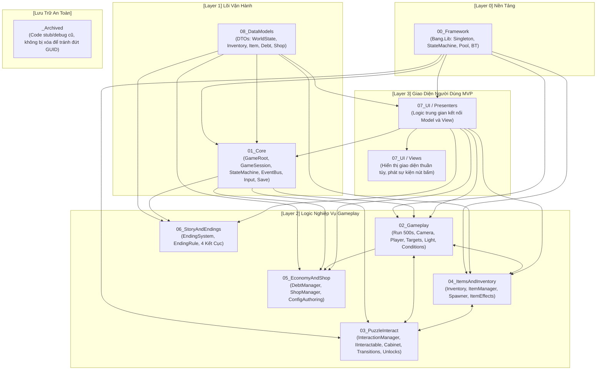
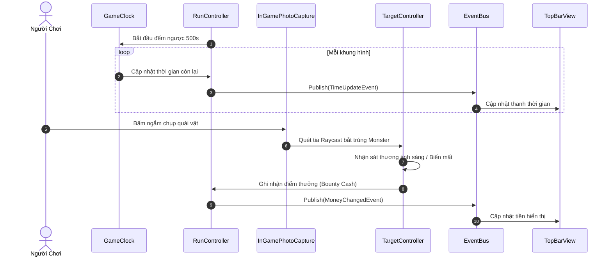
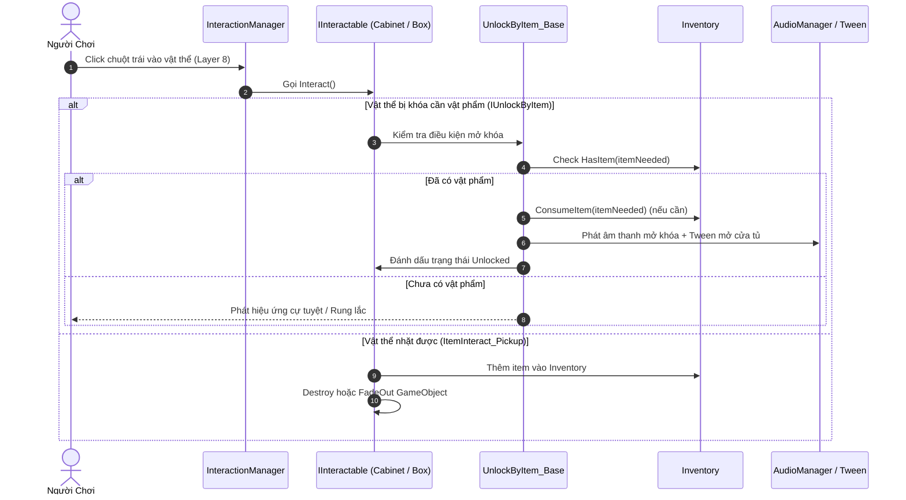
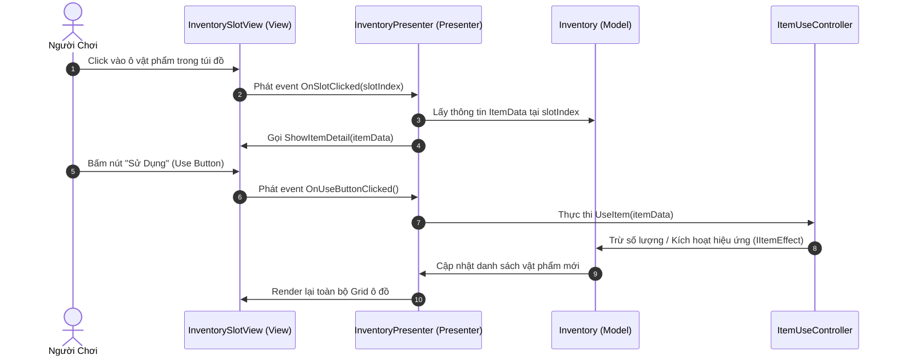

# BẢN ĐỒ MỐI QUAN HỆ MÃ NGUỒN (CODE RELATIONSHIP MAP)
## DỰ ÁN CURESHOT - GAME 2D HORROR PUZZLE & ROGUELIKE LOOP

> **Tài liệu tham chiếu kiến trúc chuẩn cho Lập Trình Viên & AI Agent.**  
> Hướng dẫn tổ chức mã nguồn, luồng giao tiếp giữa các module, và cẩm nang thao tác Thêm / Sửa / Xóa tính năng an toàn.

---

## 1. Bản Đồ Tổng Quan Kiến Trúc (Architecture Overview)

Dự án CureShot được tổ chức theo mô hình **Domain-Driven Modular Architecture** gồm 9 module chính và 1 thư mục lưu trữ an toàn:



---

## 2. Chi Tiết Từng Module & Trách Nhiệm (Directory Breakdown)

| Thư mục | Mục đích / Trách nhiệm | Các file / Thư mục con tiêu biểu | Phụ thuộc (Depends on) |
|---|---|---|---|
| **`00_Framework`** | Thư viện dùng chung, độc lập với game (`Bang.Lib`). Cung cấp Singleton, StateMachine, PoolManager, BehaviourTree, Logger. | `Singleton/Singleton_General.cs`, `State_Machine/`, `Object_Pooling/`, `Behaviour_Tree/`, `Logger/` | Unity Engine cơ bản |
| **`01_Core`** | Quản lý vòng đời trò chơi toàn cục, Session, chuyển Scene, Lưu/Tải dữ liệu, Hệ thống Input và EventBus. | `GameRoot/` (`GameRoot.cs`, `GameSession.cs`, `GameStateMachine.cs`, `SaveSystem.cs`), `EventBus/EventBus.cs`, `Input/`, `Common/` (`AsyncLoader.cs`) | `00_Framework`, `08_DataModels` |
| **`02_Gameplay`** | Vòng lặp sinh tồn 500s của màn chơi, điều khiển máy ảnh CureShot, máu & tiền tệ người chơi, quái vật & tấn công, ánh sáng và điều kiện qua ngày. | `Run/` (`RunController.cs`, `GameClock.cs`), `Camera/` (`CameraMoving.cs`, `InGamePhotoCapture.cs`), `Player/` (`PlayerManager.cs`, `HealthPlayer.cs`, `MoneyPlayer.cs`), `Targets/` (`TargetController.cs`, `TargetManager.cs`), `Environment/` (`LightManager.cs`, `CampfireLightFlicker.cs`), `Conditions/` | `00_Framework`, `01_Core`, `08_DataModels` |
| **`03_PuzzleInteract`** | Cơ chế giải đố tương tác Point & Click 2D: Click tia Raycast, mở tủ bằng DOTween, nhặt đồ, phóng to chi tiết, mở khóa ổ khóa bằng item. | `Managers/` (`InteractionManager.cs`, `TweenManager.cs`), `Interfaces/` (`IInteractable.cs`, `IUnlockByItem.cs`), `Interactions/` (`ItemInteract_Pickup.cs`, `ItemInteract_OnOff.cs`, `ItemInteract_Zoom.cs`), `Transitions/` (`CabinetTransition.cs`), `Unlocks/` (`UnlockByItem_Base.cs`, `UnlockByItem_FadeOut.cs`) | `00_Framework`, `01_Core`, `04_ItemsAndInventory` |
| **`04_ItemsAndInventory`** | Quản lý dữ liệu vật phẩm, kho đồ người chơi (Inventory), cơ chế dùng vật phẩm, điểm rơi vật phẩm và các hiệu ứng đi kèm (Hồi máu, khiên, tiền, máu). | `Database/` (`ItemLibrary.cs`, `ItemConfig.cs`), `Runtime/` (`Inventory.cs`, `ItemUseController.cs`, `WorldItemPickup.cs`), `Spawning/` (`ItemSpawnManager.cs`, `ItemSpawnPoint.cs`), `Effects/` (`HealEffect.cs`, `ShieldEffect.cs`, `BloodEffect.cs`, `CoinEffect.cs`, `GetEffect.cs`) | `00_Framework`, `01_Core`, `08_DataModels` |
| **`05_EconomyAndShop`** | Hệ thống nợ ORION (tăng dần 7 ngày), kiểm tra trả nợ cuối ngày, cửa hàng mua sắm vật phẩm hỗ trợ. | `Debt/` (`DebtManager.cs`, `DebtResult.cs`), `Shop/` (`ShopManager.cs`, `GameConfigAuthoring.cs`) | `00_Framework`, `01_Core`, `08_DataModels` |
| **`06_StoryAndEndings`** | Đánh giá điều kiện và kích hoạt 4 kết cục câu chuyện (Ending 1: Bị đào thải, Ending 2: Con nợ vĩnh viễn, Ending 3: Thoát nạn, Ending 4: Sự thật ORION). | `EndingSystem.cs`, `EndingRule.cs`, `EndingData.cs`, `EndingId.cs` | `00_Framework`, `01_Core`, `05_EconomyAndShop`, `08_DataModels` |
| **`07_UI`** | Kiến trúc **MVP (Model - View - Presenter)**. Tách rời hoàn toàn giao diện (View) và logic trung gian (Presenter). | `Views/` (`HealthBarUI.cs`, `TopBarView.cs`, `InventorySlotView.cs`, `ItemDetailView.cs`, `ItemShopView.cs`, `EndingView.cs`, `SaveSlotView.cs`, `PanelView.cs`, `UIButtonView.cs`), `Presenters/` (`CameraPresenter.cs`, `InventoryPresenter.cs`, `ShopPresenter.cs`, `EndingPresenter.cs`, `MainMenuPresenter.cs`, `SummaryPresenter.cs`), `DTO/` | `01_Core`, `02_Gameplay`, `04_ItemsAndInventory`, `05_EconomyAndShop`, `06_StoryAndEndings` |
| **`08_DataModels`** | Các DTO thuần C# (POCO) ánh xạ trực tiếp cấu trúc JSON từ `Resources/Data/` (`items.json`, `debt.json`, `shops.json`, `endings.json`, v.v.). | `ItemData.cs`, `InventoryData.cs`, `InventoryItemData.cs`, `DebtData.cs`, `ShopOfferData.cs`, `ShopStockData.cs`, `WorldStateData.cs`, `ItemSpawnData.cs` | Không phụ thuộc module nào |
| **`_Archived`** | Lưu trữ các file code cũ, class rỗng (dummy) hoặc script debug tạm thời có kèm `README.md`. | `Player.cs`, `DOTWeen_Interact.cs`, `ItemDataRuntime.cs`, `Base__EffectItem.cs`, `Base__EffectItem1.cs`, `CheckUI.cs`, `README.md` | Không tham gia vào luồng chính |

---

## 3. Bản Đồ Giao Tiếp & Luồng Dữ Liệu Chính (Key Data Flows)

### 3.1. Luồng Vòng Lặp Sinh Tồn (Survival Loop - 500s Run)


### 3.2. Luồng Tương Tác Điểm - Nhấp & Mở Khóa Giải Đố (Puzzle Interaction)


### 3.3. Luồng Giao Tiếp Giao Diện MVP (UI MVP Communication)


---

## 4. Cẩm Nang Lập Trình Viên: "Thêm / Sửa / Xóa Ở Đâu?" (Developer Cookbook)

### 4.1. Thêm một Vật Phẩm (Item) Mới Vào Game
1. **Khai báo Dữ liệu JSON:**
   * Mở file `Assets/Resources/Data/items.json`.
   * Thêm entry mới với ID duy nhất (ví dụ: `"id": "kitchen_key"`, `"name": "Chìa Khóa Nhà Bếp"`, `"description": "...", `"iconPath": "Sprite/Items/kitchen_key"`).
2. **Khai báo Hiệu ứng (Nếu item có thể sử dụng):**
   * Nếu là item hồi máu/khiên: Sử dụng các script sẵn có trong `04_ItemsAndInventory/Effects/`.
   * Nếu là hiệu ứng đặc biệt mới: Tạo script mới kế thừa `IItemEffect` trong `04_ItemsAndInventory/Effects/TenHieuUngEffect.cs`.
3. **Tạo Prefab Nhặt Trong Môi Trường (World Item):**
   * Tạo GameObject trong Scene với `SpriteRenderer`, `Collider2D` (`isTrigger = true`), đặt trên **Layer 8 (`Interactable`)**.
   * Gắn script `ItemInteract_Pickup` (`03_PuzzleInteract/Interactions/ItemInteract_Pickup.cs`).
   * Điền ID tương ứng vào trường `itemId`.

### 4.2. Thêm một Vật Thể Giải Đố / Ổ Khóa Cần Chìa (Lock / Puzzle Object)
1. **Vật thể có thể tương tác:**
   * GameObject phải có `Collider2D` (`isTrigger = true`) trên **Layer 8 (`Interactable`)**.
2. **Mở khóa bằng vật phẩm:**
   * Gắn component kế thừa từ `UnlockByItem_Base` (`03_PuzzleInteract/Unlocks/`) như `UnlockByItem_FadeOut` hoặc tạo script riêng kế thừa `UnlockByItem_Base`.
   * Cấu hình:
     - `Item Needed`: ID của chìa khóa/vật phẩm yêu cầu.
     - `On Unlock Action`: Sự kiện kích hoạt (mở cửa, mở ngăn kéo, phát âm thanh).
3. **Hiệu ứng chuyển động tủ / rương:**
   * Gắn `CabinetTransition` (`03_PuzzleInteract/Transitions/CabinetTransition.cs`) để tự động mở cánh tủ bằng DOTween khi click.

### 4.3. Thêm một Phòng Mới (Ví dụ: Nhà Bếp - Kitchen)
1. **Thiết lập Camera & Bounds:**
   * Tạo GameObject ranh giới phòng gắn `BackgroundBounds` (`02_Gameplay/Camera/BackgroundBounds.cs`).
   * Cập nhật `CameraMoving` (`02_Gameplay/Camera/CameraMoving.cs`) để quản lý chuyển đổi góc nhìn sang phòng mới.
2. **Chuyển phòng bằng nút bấm / Cửa:**
   * Gắn component chuyển phòng kế thừa `IInteractable` gọi hàm chuyển camera tới ranh giới của phòng mới.

### 4.4. Thêm một Màn Hình Giao Diện Mới (UI Screen theo chuẩn MVP)
1. **Tạo View (`07_UI/Views/`):**
   * Kế thừa `MonoBehaviour`.
   * Khai báo các thành phần UI (TextMeshProUGUI, Image, Button).
   * Cung cấp các phương thức hiển thị công khai (ví dụ: `SetData(MyDTO data)`) và các event người dùng bấm nút (ví dụ: `public event Action OnConfirmClicked;`).
   * **Tuyệt đối không viết logic tính toán trong View.**
2. **Tạo Presenter (`07_UI/Presenters/`):**
   * Kế thừa `MonoBehaviour` hoặc POCO logic.
   * Lấy dữ liệu từ Model (`01_Core` hoặc `08_DataModels`).
   * Đăng ký lắng nghe sự kiện từ View $\rightarrow$ gọi xử lý nghiệp vụ $\rightarrow$ đẩy dữ liệu mới về View.

---

## 5. Quy Chuẩn Kỹ Thuật & An Toàn Bắt Buộc (Safety Checklist)

Mọi thao tác can thiệp vào mã nguồn hoặc tài nguyên dự án phải tuân thủ nghiêm ngặt 4 nguyên tắc:

- [ ] **Bảo toàn File `.meta`:** Khi tạo, đổi tên, hoặc di chuyển file, luôn đi kèm file `.meta` tương ứng với GUID hợp lệ.
- [ ] **Bảo vệ Đường Dẫn Dữ Liệu `Resources/Data/`:** Không đổi tên hoặc di chuyển các file JSON cấu hình cốt lõi (`items.json`, `debt.json`, `shops.json`, `endings.json`).
- [ ] **Đồng Bộ `Assembly-CSharp.csproj`:** Khi thêm mới hoặc di chuyển file `.cs`, phải cập nhật thẻ `<Compile Include="..." />` trong `CureShot/Assembly-CSharp.csproj`.
- [ ] **Kiểm Tra Biên Dịch Trước Khi Hoàn Thành:** Luôn chạy lệnh `dotnet build CureShot/Assembly-CSharp.csproj` và xác nhận kết quả:
  ```text
  Build succeeded.
      0 Warning(s)
      0 Error(s)
  ```

